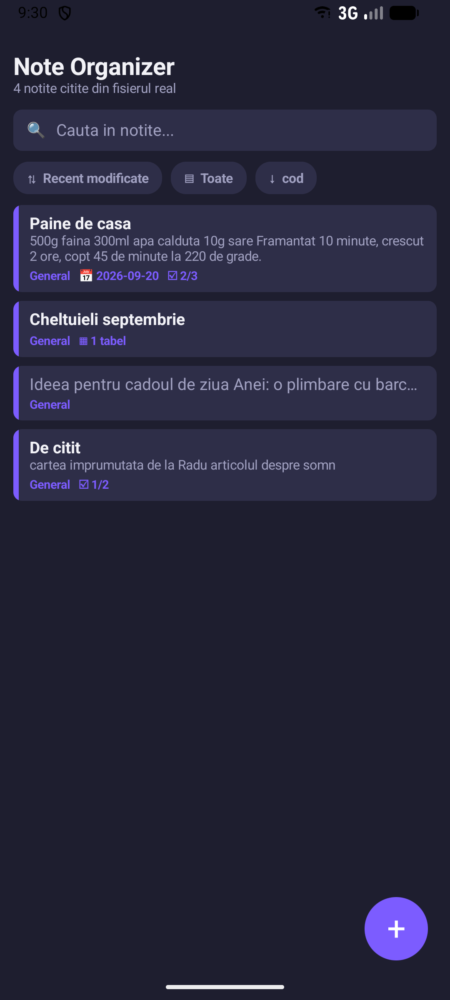
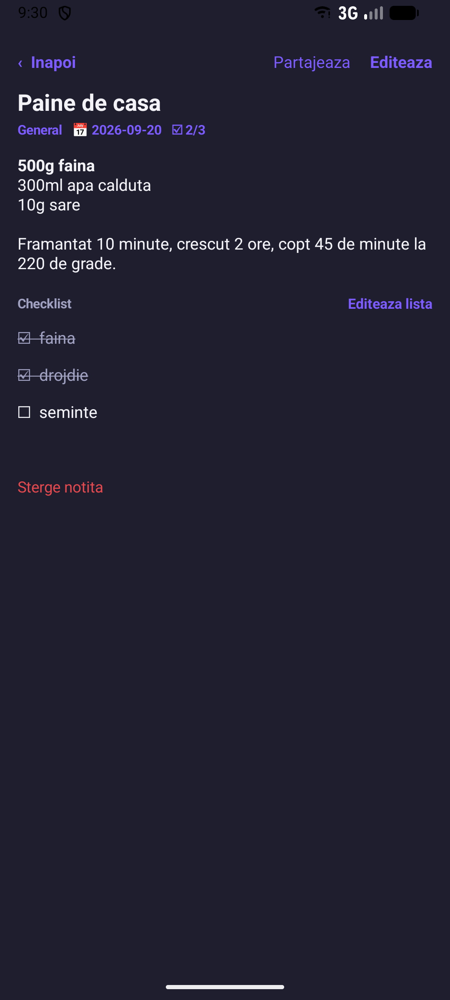
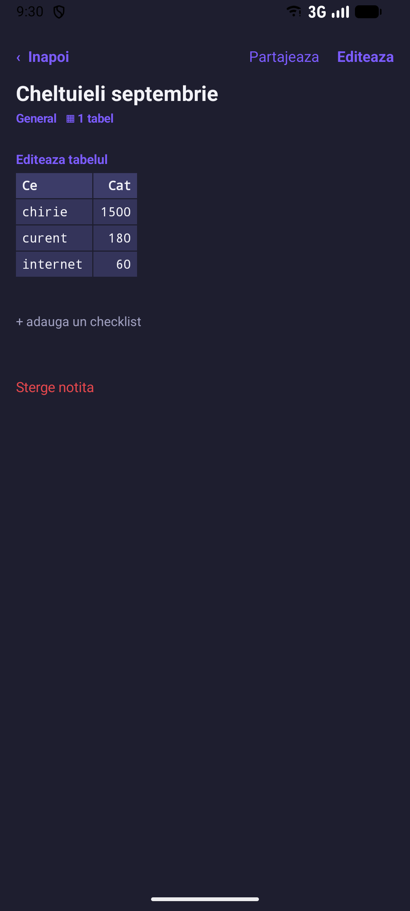
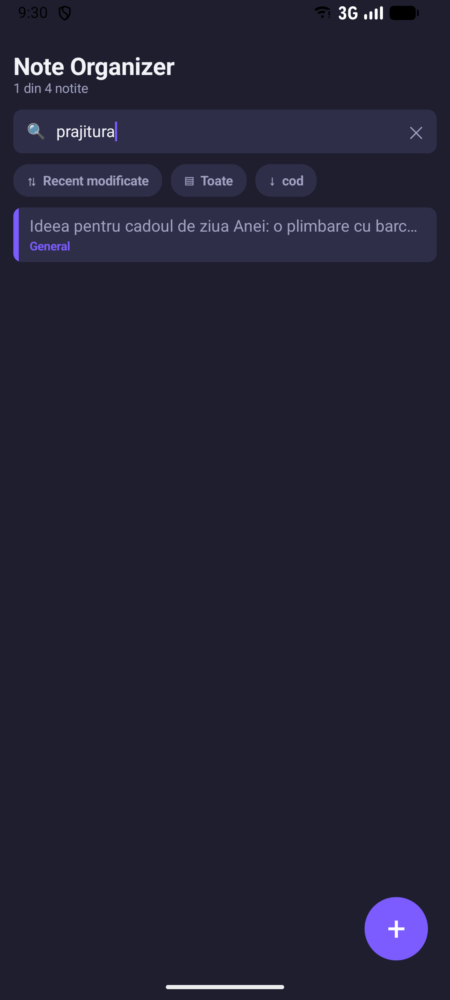

# Note Organizer, on a phone

An Android companion to [Note Organizer](https://github.com/AlexandraMoldovan95/noteOrganizer),
the offline Windows notes app. It reads and writes the **same notes file**
the desktop app writes — same JSON, same bytes, no conversion step and no
server in between.

This is an exploration rather than a product. It exists to answer two
questions honestly: does the desktop app's data format survive the trip
to a phone, and what does a phone-sized version of it actually cost?

---

  

  
  
  

The app running on an emulator, on a notebook written
for the camera rather than anybody&rsquo;s real one &mdash;
<a href="docs/screenshots/README.md">how these are made</a>.

## What it does today

Open a note and read it with its styling intact. Search the whole
notebook. Write a new note, edit an existing one, tick a checklist, file
it under a category, pin it, colour it, give it a date. Read a table as a
grid and change its cells. Delete to the Trash and restore from it —
nothing is destroyed on the phone, and the phone never empties the Trash,
because only the desktop can also delete a purged note's attachments.

And it can trade notes with the desktop, one note at a time, through a
**share code**: a long line of text you copy from one device and paste
into the other. A code that carries a note the phone already has is
recognised as *that note* — so it asks whether to update the copy here or
keep both, instead of quietly leaving you with two.

What it deliberately does not do is as much a part of the design as what
it does; [docs/STATUS.md](docs/STATUS.md) lists both, and is kept honest
on purpose.

## What it is not

**It is not sync.** Share codes move a note you choose, when you choose.
Two devices editing the same notebook still drift apart, and nothing here
reconciles that. There is no account, no server, no background exchange —
by choice, the same choice the desktop app made.

**A share code is not encryption.** It is text, compressed and encoded so
it survives a chat window. Anyone holding the code can read the note.

## Reading the documentation

Start wherever your question is.

| Document | What is in it |
|---|---|
| [docs/STATUS.md](docs/STATUS.md) | What works, what was verified and how, what is deliberately unbuilt, and the questions still open. |
| [docs/ARCHITECTURE.md](docs/ARCHITECTURE.md) | How the code is put together, and the handful of decisions that explain why it is that shape — including the one that explains the most code: a note has two representations on purpose. |
| [docs/DATA_FORMAT.md](docs/DATA_FORMAT.md) | What a note IS, in both programs — and the traps that come with re-implementing the same rules in a second language. Read before touching anything that reads or writes a note. |
| [docs/ISSUES_LOG.md](docs/ISSUES_LOG.md) | What actually went wrong, how it was found, and what kind of failure it turned out to be. The most useful document here, and the least flattering. |
| [CHANGELOG.md](CHANGELOG.md) | What changed in each version, and how the numbers are decided. |
| [qa/README.md](qa/README.md) | How this app is tested: four layers, and what only each one can catch. |
| [CLAUDE.md](CLAUDE.md) | How work is done in this folder: the rules, the approvals, and the environment traps that cost a day each. |

The desktop app is the specification. Where a rule here answers "what
should this do?", the answer comes from reading its Python, not from
inventing behaviour — including in the places where the Python is
arguably the worse choice, because a difference between the two is a
surprise rather than a feature.

## Building and running it

Requirements: Android Studio (or a JDK plus the Android SDK) and an
emulator or a phone with USB debugging on. Minimum Android 8.0 (API 26).

`gradlew` needs a JDK and will not start without one — there is no
system-wide Java on this machine, and the only JDK is the one bundled
inside Android Studio:

    set JAVA_HOME=C:\Programs\android_studio\jbr

    gradlew.bat assembleDebug          # build the APK
    gradlew.bat testDebugUnitTest      # 221 JVM unit tests, no device needed
    adb install -r app\build\outputs\apk\debug\app-debug.apk

The test task prints nothing useful when it fails; the results are XML in
`app\build\test-results\testDebugUnitTest\`, and the count in those files
is the only proof the tests actually ran.

The app looks for `notes_data.json` in its own app-private folder on the
device. To try it against a real notebook, copy one in:

    adb push notes_data.json /sdcard/Android/data/com.example.noteorganizer/files/

That copy is yours to break — it is not the desktop's file, and nothing
here ever reaches back to the machine that wrote it.

## The icon is the desktop's icon

    py tools/make_launcher_icon.py

It imports the desktop app's `tools/make_icon.py` and asks for the same
drawing at Android's sizes — not a copy, and not a second icon that
merely rhymes with the first. The two programs are one product, and an
icon is the first thing anybody sees of either. It reads that file and
never writes to it, like everything else here that touches the desktop.

What ships: `mipmap-*/ic_launcher*.webp` at five densities for older
phones, plus the two adaptive layers and their `mipmap-anydpi-v26` XML
for Android 8 and later. **Android Studio's template icon — the green
robot — is gone**, along with the two vector drawables it came with.

The one number that matters is how big the mark is drawn inside the
adaptive canvas. The system keeps only the middle 72 of 108 units and
then masks that into a circle, so a square mark has to fit the circle
*inscribed* in the safe square: 72/108 ÷ √2, about 47%. Drawn at the
full 72/108 it came back from the phone with its frame cut off at every
corner — and the preview that had approved it was composing the layers
**without** the system's crop, so it flattered the icon by exactly the
amount that mattered. The preview crops now too.

## The gate that guards the contract

    py tools/check_note_shape.py

This project's whole premise is that both programs read and write the
same file, and nothing enforced that: the agreement lives in two
languages in two repositories, and drifts in silence — the code compiles,
the tests pass, and the damage shows up on a real notebook that has
travelled. It has already happened twice.

So the gate reads the desktop's Python **as the specification** and
compares four things: that a note here has the same fields the desktop
gives one, that the two places building a new note agree with each other,
that a share code carries what the desktop's codes carry, and that an
arriving note replaces what the desktop lets one replace. It reads that
source and never writes to it.

Run it before calling anything about the note format done. Its own four
kinds of drift were tried against it and all four turned it red — a gate
that has never been seen failing is decoration.

A second gate guards a different agreement:

    py tools/check_layering.py

`Notebook.kt`, `Sharing.kt`, `Tables.kt` and `Styling.kt` contain no
`import android` and no `import androidx` — that is what lets their tests
run on a laptop in seconds instead of on an emulator in minutes. The leak
would be quiet: reach for `android.util.Base64` because it is first in
the autocomplete and everything still compiles, still runs, and can no
longer be tested without a device. So it is checked rather than
remembered.

Both gates run on every push, together with the unit tests — see
[.github/workflows/tests.yml](.github/workflows/tests.yml). The contract
gate fetches the desktop app in CI and is run with `--require-desktop`,
because a check that quietly could not run reads exactly like a check
that passed. Reading a private repository from another one needs a token:
[qa/README.md](qa/README.md#what-runs-on-every-push) says which, and
where it goes.

## The test plan

`qa/NoteOrganizer_Android_TestPlan.xlsx` — 35 cases across nine areas,
the same shape as the desktop app's plan and kept here because the two
projects are deliberately separate.

Its "Who runs it" column is the point: **21** rows are already walked by
unit tests, **12** are driven on the emulator by the tools in
[tools/emulator/](tools/emulator/), and **12** need a person with a real
phone in their hand — whether a tap lands, whether the keyboard covers
what you are typing, whether it reads well at arm's length. Those twelve
are the reason the file exists; a script cannot answer one of them. (The
three numbers exceed 35 because a row can carry two: a rule proved on the
JVM whose screen still has to be looked at.)

## How it is tested

The unit tests run on the JVM without a device, and they pin the rules
that were ported from Python rather than the screens. Every one of them
has been watched failing: the check is broken on purpose, the suite is
run, and the failure is read before the break is reverted. A mutant that
produces no test results at all is not a passing one — that has happened
three times here, for three different reasons, and
[docs/STATUS.md](docs/STATUS.md) keeps the list.

The parts that matter most are not judged by this app at all. A note
captured on the phone is pulled back and checked **in the desktop's own
Python**: every pre-existing note identical field for field, the new note
passing the desktop's `normalize_note` unchanged, every id unique. A
suite proves the code does what it says it does; that proves the two
programs agree about what a note is.
