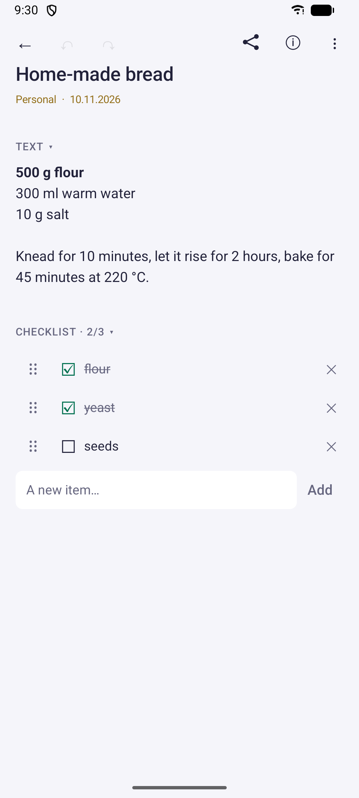
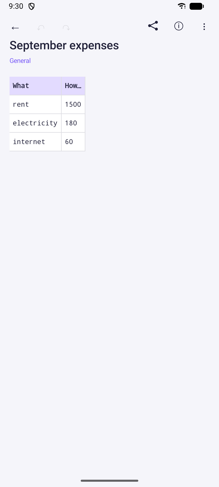
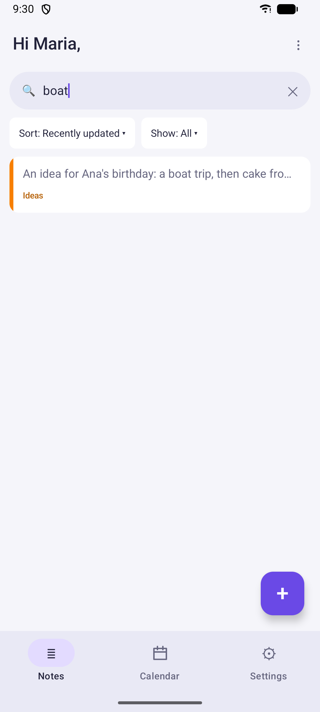

# Note Organizer on Android

An Android companion to [Note Organizer](https://github.com/AlexandraMoldovan95/noteOrganizer),
the offline Windows notes app. It reads and writes the **same notes file**
the desktop app writes — same JSON, same bytes, no conversion step and no
server in between.

This is an exploration rather than a product. It exists to answer two
questions honestly: does the desktop app's data format survive the trip
to Android, and what does a touch-sized version of it actually cost?

---

  

  
  
  

The app running on an emulator, on a notebook written
for the camera rather than anybody&rsquo;s real one &mdash;
<a href="docs/screenshots/README.md">how these are made</a>.

## What it does today

Open a note and read it with its styling intact. Search the whole
notebook. Write a new note, edit an existing one, tick a checklist, file
it under a category, pin it, colour it, give it a date. Read a table as a
grid and change its cells. Delete to the Trash and restore from it —
nothing is destroyed on the phone, and the phone never empties the Trash,
because only the desktop can also delete a purged note's attachments.

And it can trade notes with the desktop, one note at a time, through a
**share code**: a long line of text you copy from one device and paste
into the other. A code that carries a note the phone already has is
recognised as *that note* — so it asks whether to update the copy here or
keep both, instead of quietly leaving you with two.

What it deliberately does not do is as much a part of the design as what
it does; [docs/STATUS.md](docs/STATUS.md) lists both, and is kept honest
on purpose.

## What it is not

**It is not sync.** Share codes move a note you choose, when you choose.
Two devices editing the same notebook still drift apart, and nothing here
reconciles that. There is no account, no server, no background exchange —
by choice, the same choice the desktop app made.

**A share code is not encryption.** It is text, compressed and encoded so
it survives a chat window. Anyone holding the code can read the note.

## Documentation

Start wherever your question is.

| Document | What is in it |
|---|---|
| [docs/STATUS.md](docs/STATUS.md) | What works, what was verified and how, what is deliberately unbuilt, and the questions still open. |
| [docs/ARCHITECTURE.md](docs/ARCHITECTURE.md) | How the code is put together, and the handful of decisions that explain why it is that shape — including the one that explains the most code: a note has two representations on purpose. |
| [docs/DATA_FORMAT.md](docs/DATA_FORMAT.md) | What a note IS, in both programs — and the traps that come with re-implementing the same rules in a second language. Read before touching anything that reads or writes a note. |
| [docs/ISSUES_LOG.md](docs/ISSUES_LOG.md) | What actually went wrong, how it was found, and what kind of failure it turned out to be. The most useful document here, and the least flattering. |
| [CHANGELOG.md](CHANGELOG.md) | What changed in each version, and how the numbers are decided. |
| [qa/README.md](qa/README.md) | How this app is tested: four layers, and what only each one can catch. |
| [tools/emulator/README.md](tools/emulator/README.md) | The scripts that drive the emulator — tap, type, photograph — and the ways the emulator lies to a script. |
| [docs/screenshots/README.md](docs/screenshots/README.md) | Where the pictures come from, and how one command remakes them. |
| [CLAUDE.md](CLAUDE.md) | How work is done in this folder: the rules, the approvals, and the environment traps that cost a day each. |

The desktop app is the specification. Where a rule here answers "what
should this do?", the answer comes from reading its Python, not from
inventing behaviour
([why, and how it is enforced](docs/ARCHITECTURE.md#the-desktop-is-the-specification)).

## Building and running it

Requirements: Android Studio (or a JDK plus the Android SDK) and an
emulator or a device with USB debugging on. Minimum Android 8.0 (API 26).

`gradlew` needs a JDK and will not start without one — there is no
system-wide Java on this machine, and the only JDK is the one bundled
inside Android Studio:

    set JAVA_HOME=C:\Programs\android_studio\jbr

    gradlew.bat assembleDebug          # build the APK
    gradlew.bat testDebugUnitTest      # 221 JVM unit tests, no device needed
    adb install -r app\build\outputs\apk\debug\app-debug.apk

The test task prints nothing useful when it fails; the results are XML in
`app\build\test-results\testDebugUnitTest\`, and the count in those files
is the only proof the tests actually ran.

The app looks for `notes_data.json` in its own app-private folder on the
device. To try it against a real notebook, copy one in:

    adb push notes_data.json /sdcard/Android/data/ro.noteorganizer.app/files/

That copy is yours to break — it is not the desktop's file, and nothing
here ever reaches back to the machine that wrote it.

### The icon is the desktop's icon

    py tools/make_launcher_icon.py

It imports the desktop app's `tools/make_icon.py` and asks for the same
drawing at Android's sizes — not a copy, and not a second icon that
merely rhymes with the first. It reads that file and never writes to it,
like everything else here that touches the desktop. Android Studio's
template icon — the green robot — is gone. What ships is listed in the
[changelog](CHANGELOG.md#050--2026-09-14); why the mark is drawn at 47%
of the canvas is in the
[issues log](docs/ISSUES_LOG.md#the-preview-that-flattered-the-icon).

## How it is checked

| Check | Run it with | What it catches |
|---|---|---|
| Unit tests, on the JVM | `gradlew.bat testDebugUnitTest` | A rule ported from Python that does not match the Python |
| The contract gate | `py tools/check_note_shape.py` | The two programs quietly disagreeing about what a note *is* |
| The layering gate | `py tools/check_layering.py` | Android leaking into the rules layer, which would push its tests onto a device |
| The language gate | `py tools/check_english.py` | Romanian reaching anything written for a developer; the app's own Romanian words are exempt |
| The emulator tools | [tools/emulator/](tools/emulator/) | A rule that is right and a screen that is wrong |
| The test plan | `qa/NoteOrganizer_Android_TestPlan.xlsx` | What only a person with a real phone in their hand can judge |

The unit tests pin the rules that were ported from Python rather than the
screens, and every one of them has been watched failing — broken on
purpose, run, read, reverted. A mutant that produces no test results at
all is not a passing one; that has happened three times here, for three
different reasons
([the story](docs/ISSUES_LOG.md#a-silent-mutant-is-not-a-passing-one)).

The parts that matter most are not judged by this app at all. A note
captured on the phone is pulled back and checked **in the desktop's own
Python** ([what was compared](docs/STATUS.md#how-each-part-was-verified)).
A suite proves the code does what it says it does; that proves the two
programs agree about what a note is. Run the contract gate before calling
anything about the note format done
([why it exists](qa/README.md#the-gate-between-the-two-programs)).

The test plan has 35 cases — the same shape as the desktop app's plan,
kept here because the two projects are deliberately separate. Its "Who
runs it" column says which cases a unit test or the emulator already
walks, and which twelve need a person with a real phone in their hand:
whether a tap lands, whether the keyboard covers what you are typing,
whether it reads well at arm's length. Those twelve are the reason the
file exists; a script cannot answer one of them. The full map, and what
runs in CI on every push: [qa/README.md](qa/README.md).
