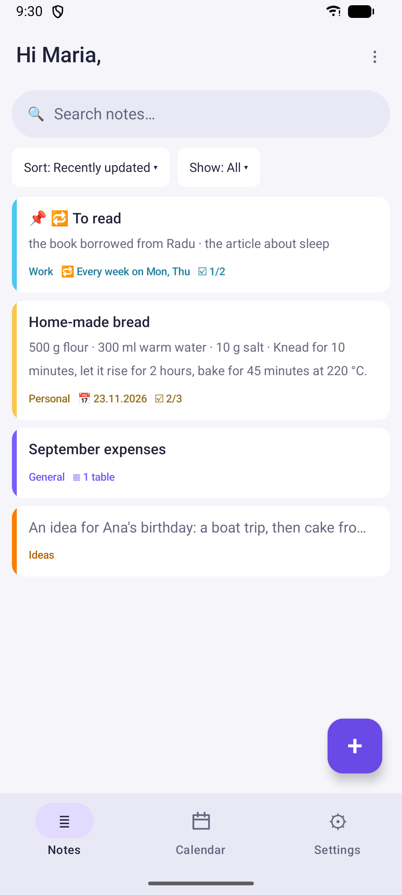
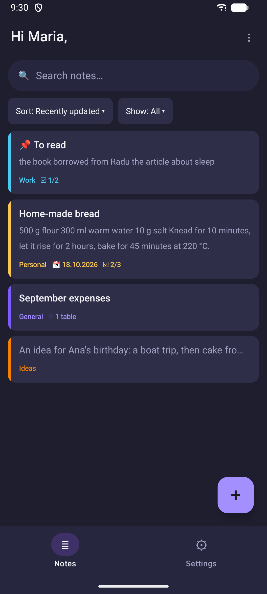
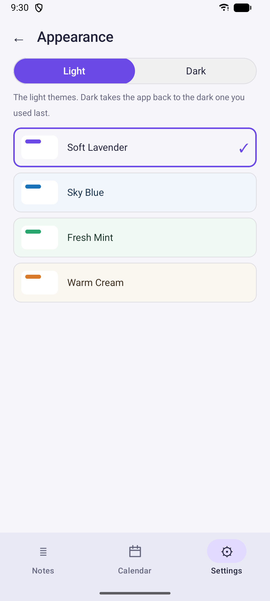

# Note Organizer on Android

The Android companion to [Note Organizer](https://github.com/AlexandraMoldovan95/noteOrganizer),
the offline Windows notes app. Same notes, same rules, same files — the
phone keeps a notebook of its own, in exactly the desktop's format, and a
note or a whole notebook moves between the two whenever you send it.

No account, no server, no sync: like the desktop, it works entirely
offline, and nothing that arrives from the other device is ever written
over a note without asking. One difference: while the phone's own backup
to a Google account is on, Android copies the app's notes there too;
Settings → Backup turns the app's part off, and the privacy policy
(Settings → About) says more.

---

  
  

  
  
  
  
  

  

The app running on an emulator, on a notebook written
for the camera rather than anybody&rsquo;s real one &mdash;
<a href="docs/screenshots/README.md">how these are made</a>.

## What it does

- **Write and edit** in one screen that saves itself, with Undo and Redo:
  formatting, sizes and faces, lists, tables written right in their
  cells, with a bar of plain buttons for the rest — captions and column
  widths too — checklists you can tick and
  drag, comments, attached files, and a note's category, colour, date and
  pin. **Copy and paste keep the formatting**, from a web page or into a
  mail, through the menu's Paste: a keyboard's own clipboard types the
  words in, plain. Find in a note, a calculator under it, templates, and export as a
  web page or plain text. A big deletion can be undone with the
  desktop's **↩ Restore previous**.
- **The calendar and repeating notes**: the month with each day's notes,
  painted days and markers, the History, repeats chosen on a sheet, and
  one day of a series edited on its own or moved to another date. **The
  day's reminder**: a bar when the app opens on a day with notes, and, if
  you turn it on, a notification at the hour you choose.
- **Find and organise**: search by the desktop's rule (diacritics folded, checklists too),
  the desktop's every sort and filter, Custom order arranged by hand,
  groups by category, duplicates found and cleaned up, long press to
  select, pin, move, duplicate or delete several at once — with Undo.
- **A phone or a tablet**, upright or on its side: from a small tablet's
  width the tabs become a rail down the left edge, and on a wide screen
  the note opens beside the list. Walked on a small phone and on tablets
  of 7, 10 and 14 inches.
- **The Trash**, kept for the desktop's window and emptied on its own.
- **Your look**: the desktop's eight themes, four light and four dark,
  under one Light | Dark switch.
- **Share a note** with anyone, through the phone's own share sheet —
  WhatsApp, mail, Teams: as a PDF of its page, a web page, its words, or
  a share code. The app sends nothing itself.
- **Move notes to and from the desktop.** One note as a **share code** —
  text you send through any app — or the whole notebook as the desktop's
  own **backup `.zip`**. A note that arrives where a copy of it already
  lives is recognised, and you choose: update it, or add it as a new one.

The full list, what is deliberately not built yet, and how each part was
verified are in [docs/STATUS.md](docs/STATUS.md).

## What it is not

**It is not sync.** Codes and backups move notes when you choose. Two
devices editing the same note still drift apart until one sends it to the
other — and then the person decides, never a clock.

**A share code is not encryption.** It is text, compressed and encoded so
it survives a chat window. Anyone holding the code can read the note.

## How it was built

Alexandra Moldovan built it with Claude Code, Anthropic's AI coding
agent, as she built the desktop app. She decided what it should do, used
it on her own phone and reported what went wrong there, chose between the
options the agent put forward, and approves what is merged. The agent
wrote most of the code and the documentation, working under the rules in
[CLAUDE.md](CLAUDE.md); its commits carry a `Co-Authored-By` line. In her
own words: [In my words](https://github.com/AlexandraMoldovan95/noteOrganizer/blob/main/docs/IN_MY_WORDS.md),
in the desktop app's repository, which also tells
[how the final audit before the stores was run](https://github.com/AlexandraMoldovan95/noteOrganizer/blob/main/docs/AI_WORKFLOW.md#the-final-audit).

## Documentation

Start wherever your question is.

| Document | What is in it |
|---|---|
| [docs/STATUS.md](docs/STATUS.md) | What works, what was verified and how, what is not built yet, and the questions still open. |
| [docs/ARCHITECTURE.md](docs/ARCHITECTURE.md) | How the code is put together, and the decisions that explain its shape — including the one that explains the most code: a note has two representations on purpose. |
| [docs/DATA_FORMAT.md](docs/DATA_FORMAT.md) | What a note IS, in both programs; the settings, codes and backups they share — and the traps that come with re-implementing the same rules in a second language. Read before touching anything that reads or writes a note. |
| [docs/ISSUES_LOG.md](docs/ISSUES_LOG.md) | What actually went wrong, how it was found, and what kind of failure it turned out to be. The most useful document here, and the least flattering. |
| [CHANGELOG.md](CHANGELOG.md) | What changed in each version, and how the numbers are decided. |
| [qa/README.md](qa/README.md) | How this app is tested: the layers, and what only each one can catch. |
| [tools/emulator/README.md](tools/emulator/README.md) | The scripts that drive the emulator — walk, tap, type, photograph — and the ways the emulator lies to a script. |
| [docs/screenshots/README.md](docs/screenshots/README.md) | Where the pictures come from, and how one command remakes them. |
| [CLAUDE.md](CLAUDE.md) | How work is done in this folder: the rules, the approvals, and the environment traps that cost a day each. |

The desktop app is the specification. Where a rule here answers "what
should this do?", the answer comes from reading its Python, not from
inventing behaviour
([why, and how it is enforced](docs/ARCHITECTURE.md#the-desktop-is-the-specification)).

## Building and running it

Requirements: Android Studio (or a JDK plus the Android SDK) and an
emulator or a device with USB debugging on. Minimum Android 8.0 (API 26).

`gradlew` needs a JDK and will not start without one. Where no other is
installed, point it at the one bundled inside Android Studio:

    set JAVA_HOME=<Android Studio's folder>\jbr

    gradlew.bat assembleDebug          # build the APK
    gradlew.bat testDebugUnitTest      # the JVM unit tests, no device needed
    adb install -r app\build\outputs\apk\debug\app-debug.apk

The test task prints nothing useful when it fails; the results are XML in
`app\build\test-results\testDebugUnitTest\`, and
`py tools\check_test_results.py` reads them — refusing any that are older
than the code.

The app keeps its notebook in its own private storage. To try it with a
real notebook, export a backup from the desktop (Settings → Backup), put
the `.zip` anywhere on the device, and import it from the app's
Settings → Backup. That copy is yours to break — nothing here ever
reaches back to the machine that wrote it.

### The icon is the desktop's icon

    py tools/make_launcher_icon.py

It imports the desktop app's `tools/make_icon.py` and asks for the same
drawing at Android's sizes — not a copy, and not a second icon that
merely rhymes with the first. It reads that file and never writes to it,
like everything else here that touches the desktop. Why the mark is drawn
at 47% of the canvas is in the
[issues log](docs/ISSUES_LOG.md#the-preview-that-flattered-the-icon).

## How it is checked

| Check | Run it with | What it catches |
|---|---|---|
| Unit tests, on the JVM ([how many, by suite](qa/README.md#the-unit-tests)) | `gradlew.bat testDebugUnitTest` | A rule ported from Python that does not match the Python |
| The note-shape gate | `py tools/check_note_shape.py` | The two programs quietly disagreeing about what a note *is* |
| The palette gate | `py tools/check_palettes.py` | A theme or a colour drifting from the desktop's |
| The layering gate | `py tools/check_layering.py` | Android leaking into the rules layer, which would push its tests onto a device |
| The language gate | `py tools/check_english.py` | Romanian reaching the repository, the app included |
| The release gate | `py tools/check_release_lookups.py`, after `gradlew.bat assembleRelease` | Code the shrinker renamed, still looking a file up by its old place |
| The licenses gate | `py tools/make_licenses.py --check`, after `gradlew.bat assembleRelease` | A library in the APK that Settings → About → Open-source licenses does not name |
| The interop gate | `py tools/check_interop.py`, after the unit tests | A share code made on the phone that the desktop's own Python reads differently |
| The emulator walk | `py tools/emulator/walk.py <folder>` | A rule that is right and a screen that is wrong — [its parts and checks](qa/README.md#the-emulator-walk), each reading the file the app wrote |
| The test plan | `qa/NoteOrganizer_Android_TestPlan.xlsx` | What only a person with a real phone in their hand can judge |

The unit tests pin the rules ported from Python rather than the screens.
A fix comes with a check watched failing: the fix broken on purpose — a
mutant — run, read, put back. Those that still aim at today's code are in
`tools/mutants.json`, run with `py tools/mutate.py`
([how many](qa/README.md#the-house-rules)). A mutant that produces no test results at all is
not a passing one ([the story](docs/ISSUES_LOG.md#a-silent-mutant-is-not-a-passing-one)).

The parts that matter most are not judged by this app at all. A note
written on the phone, a share code and a backup made here were each
checked **in the desktop's own Python**, and the ports since Phase 2 —
repeats, the calculator, the export, templates, renumbered lists, pasted
HTML — give back every answer the desktop's functions gave over hundreds
of cases, save the few where the desktop is wrong and the phone says why
([what was compared](docs/STATUS.md#how-each-part-was-verified)). A suite
proves the code does what it says it does; that proves the two programs
agree.

The test plan marks which cases a unit test or the emulator already
walks, and which need a person with a real phone: whether a tap lands,
whether the keyboard covers what you are typing, whether it reads well at
arm's length — and whether the words say what they mean. A script cannot
answer one of those. The full map, and what runs in CI (on `main` and on pull requests):
[qa/README.md](qa/README.md).

## License

[MIT](LICENSE) © 2026 Alexandra Moldovan. The libraries the app is built
with come under the Apache License 2.0; Settings → About → Open-source
licenses lists them, with its text.
