# Screenshots

Every image here is **this app running on an emulator** — nothing is a
mockup, a render, or a picture from anywhere else. The launcher icon in
them is not a picture at all: it is drawn from code by
[`tools/make_launcher_icon.py`](../../tools/make_launcher_icon.py), which
asks the desktop app's own drawing for Android's sizes.

## The pictures

  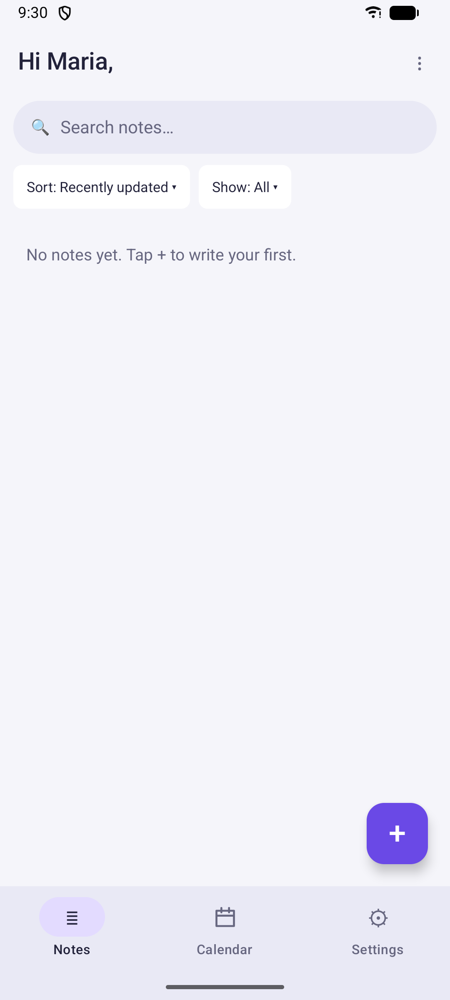
  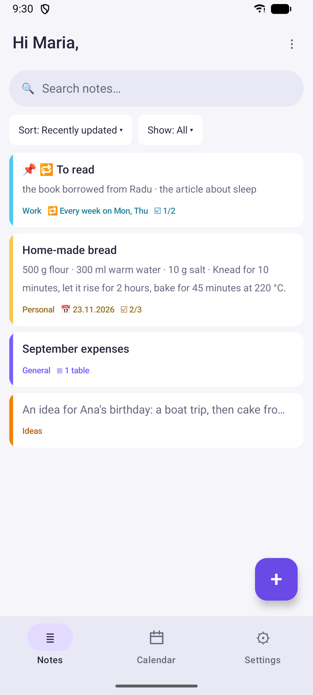
  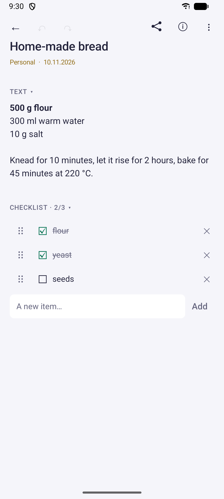
  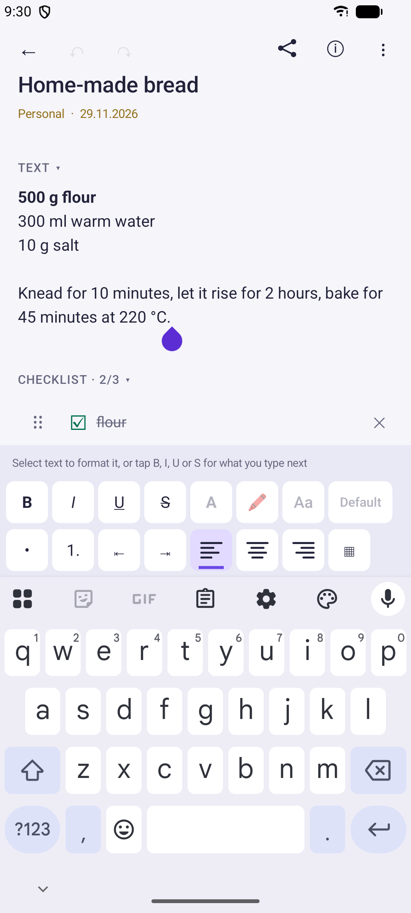

  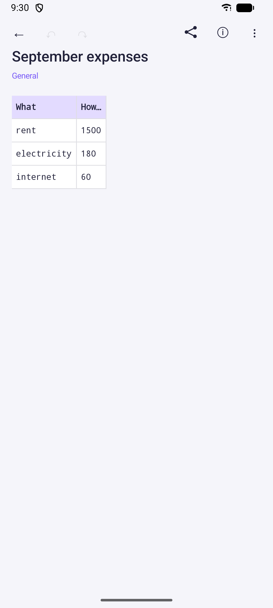
  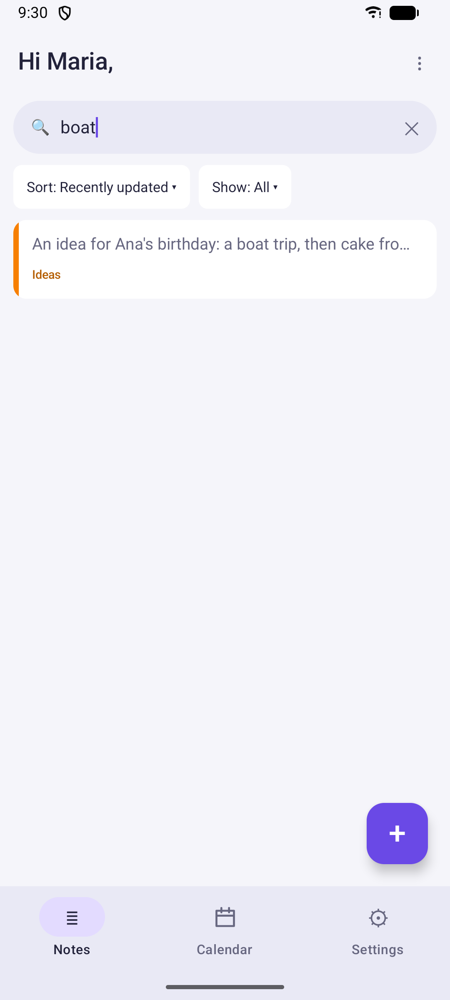
  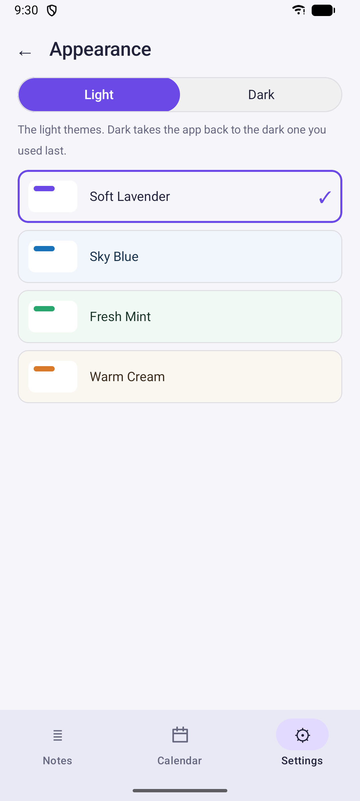
  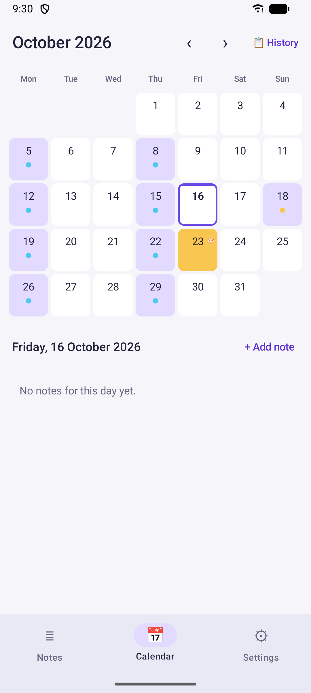

  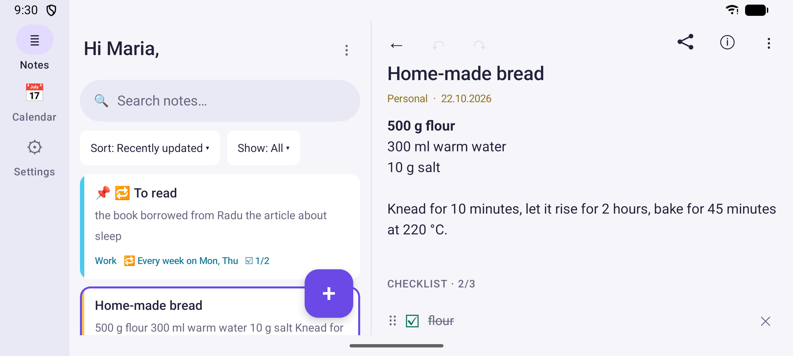
  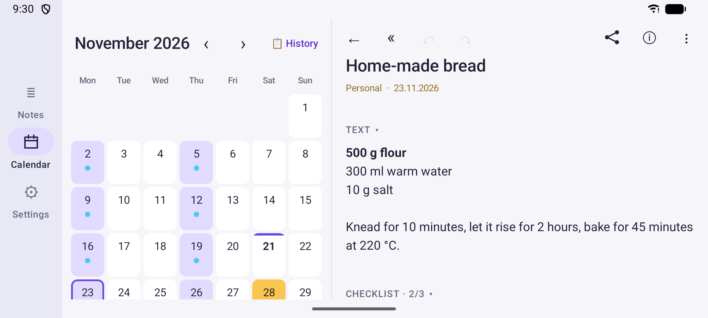

  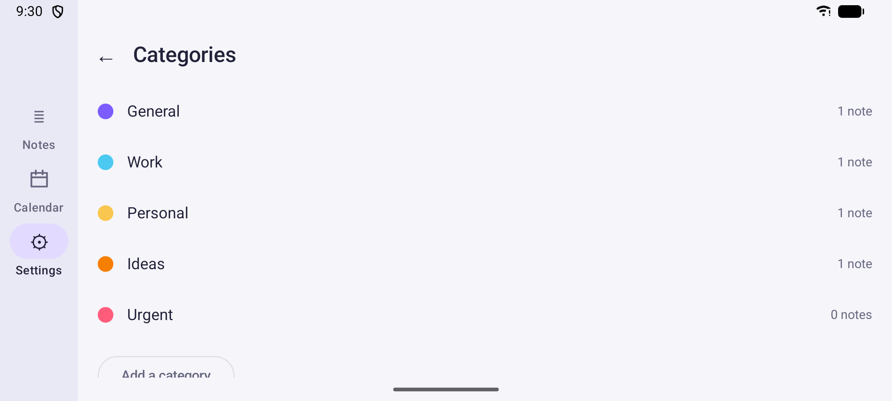

The same screens in Midnight Purple

  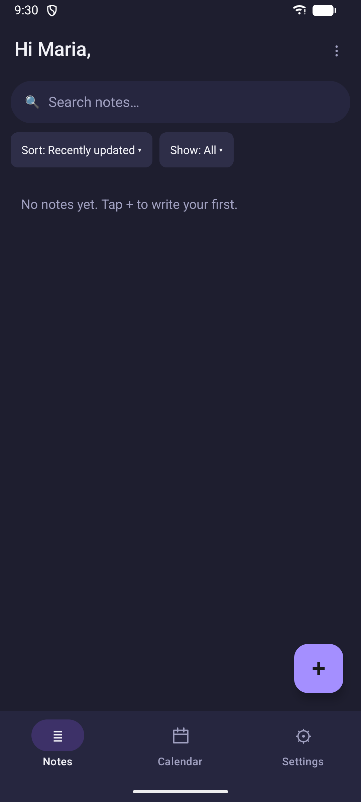
  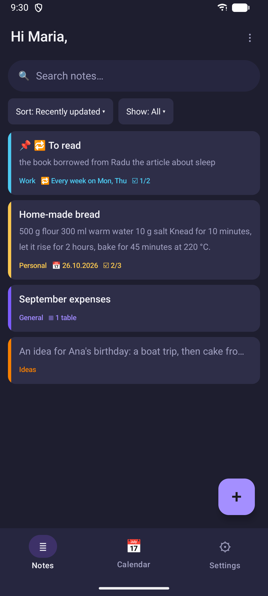
  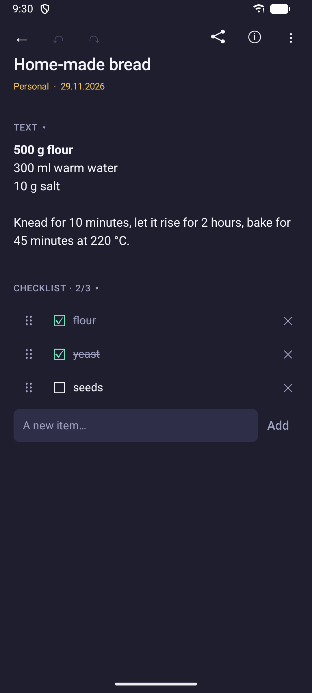
  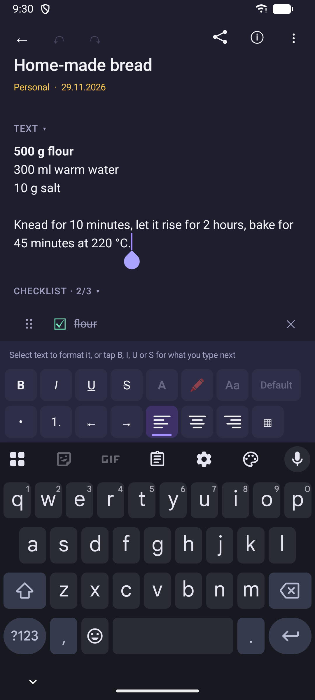

  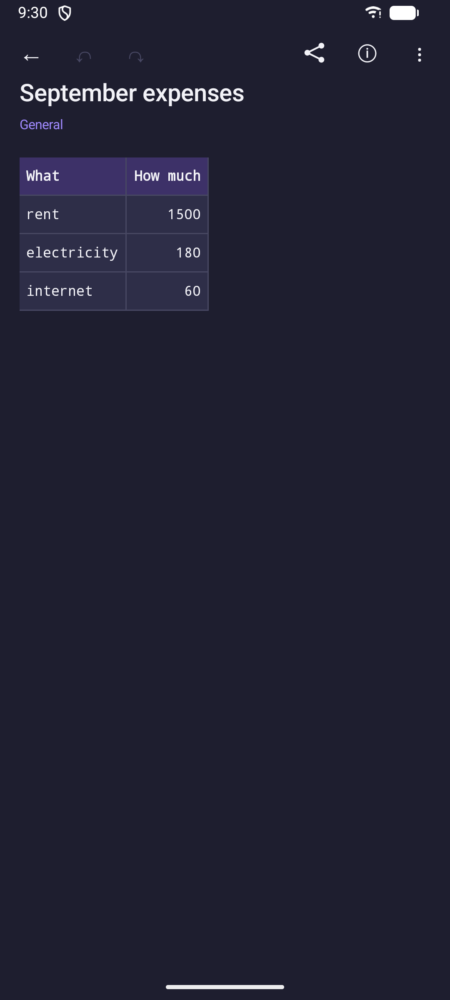
  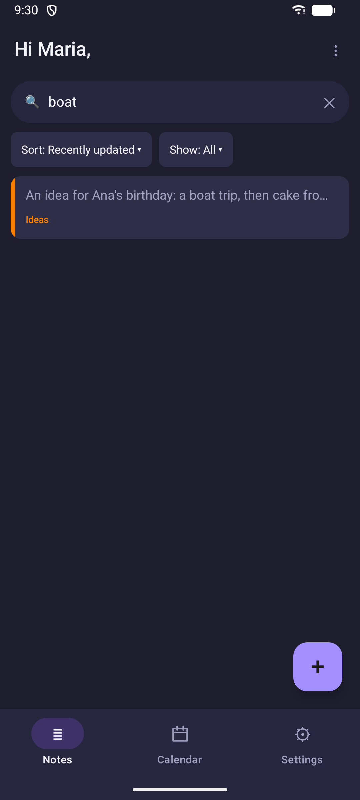
  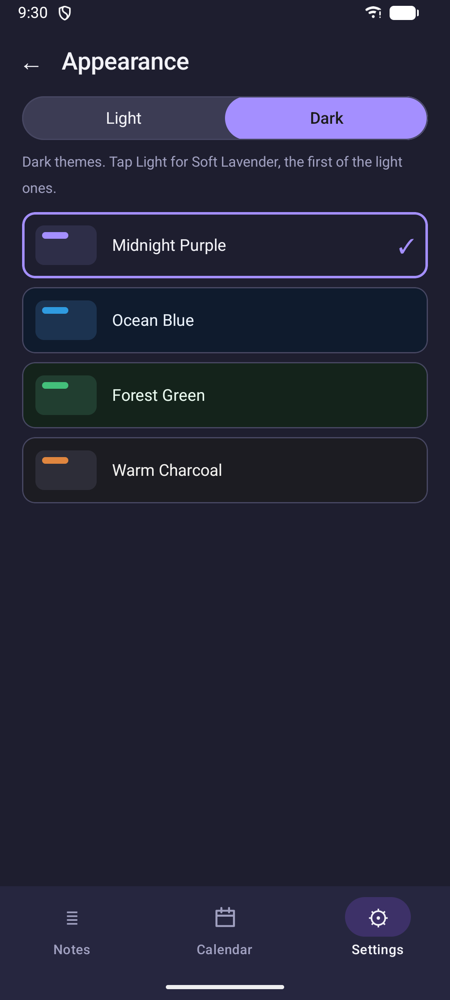
  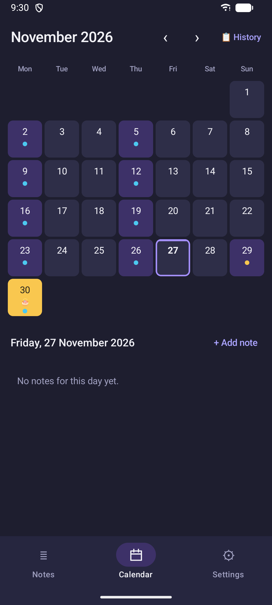

  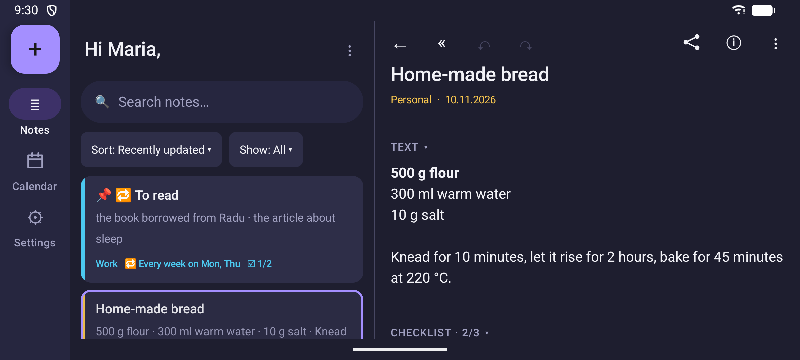
  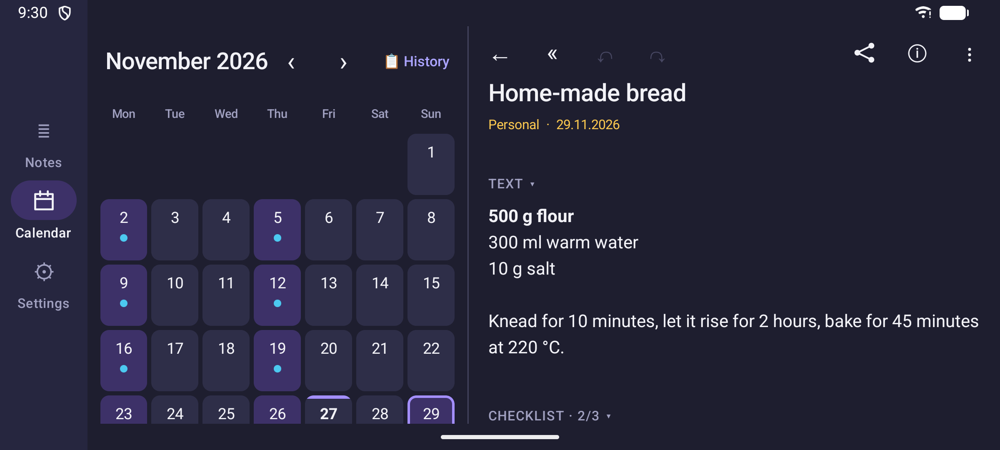

  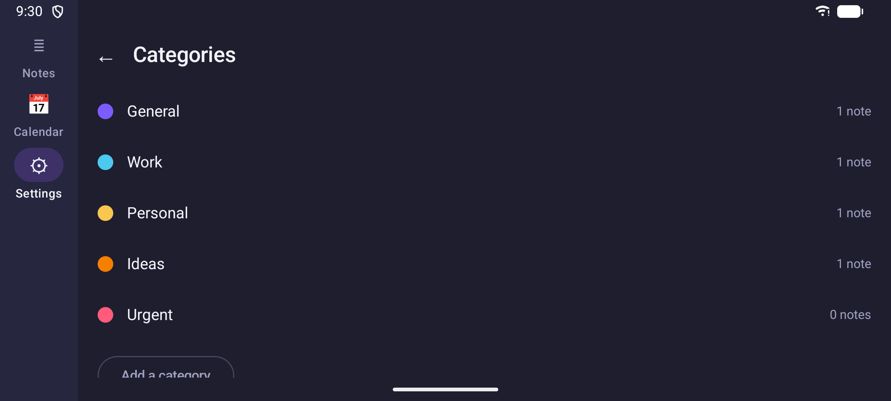

What each one shows is in [the set](#the-set), below; the README shows
the moving picture, `demo.gif`, alone.

## They are taken by a script, not by hand

    py tools/emulator/take_screenshots.py          the stills, both themes
    py tools/emulator/take_screenshots.py --gif    demo.gif, the README's moving picture

One command remakes the whole set, which is the point: a set refreshed by
hand is a set that quietly goes half-stale, one picture at a time. The
GIF is ten frames of the same kind, each taken only when the screen says
what it must; a note is written in it, its keyboard left in those frames
because that is what a person writing sees, and the note is read back
from the file before the GIF is written.

The script does four things worth knowing about:

**It writes its own notebook first.** A real notebook is somebody's
private writing, and documentation is the one place it must never end up.
So the app's data is cleared and four notes written *for* the camera go
straight into its own storage — a bread recipe with a checklist, a month
of expenses as a table, an untitled idea, a pinned reading list that
repeats every Monday and Thursday — chosen to show a headline, a
preview, the badges, a pin, a series and a note with no title at all.
The name, the theme and a painted day for the calendar are set the same
way, so the first screen is the list, with no welcome note and no notice
in the way.

**It names what must be on screen before the shutter opens** — and, for
the search, what must be *gone*. Each shot carries a short list of words,
the live UI tree is read and checked against it, and a screen that does
not say them is not photographed. A tool that captures whatever happens
to be there is how a picture of the wrong screen ends up in the
documentation looking like proof — which is exactly what nearly happened
here, when a failed tap left the search shot showing the plain list
([the story](../ISSUES_LOG.md#a-photograph-of-the-wrong-screen-filed-as-proof)).

**It quiets the phone's own furniture.** Android's SystemUI demo mode
fixes the clock at 9:30 and the battery at full, so the frame is the app
rather than whatever notification the emulator had pending that
afternoon; the mobile-signal icon is hidden, because demo mode draws it
white whatever the page behind it. It is all turned off again at the
end. The on-screen keyboard is dismissed before every still picture but
one — it is half the screen and none of it is this app — and kept in
`12-writing`, whose point is the format bar standing on it, and in the
four frames of the moving picture that show the typing. The keyboard
follows the phone's light or dark, not the app's, so the dark pass sets
the phone dark too, and puts it back as it was after.

**The pictures are looked at before they are committed.** Two bugs were
found that way while this set was made: the card printing a date the way
the file stores it rather than the way the desktop shows it
([the story](../ISSUES_LOG.md#the-same-date-written-two-ways)), and that
white signal icon.

## The set

| File | What it shows |
|---|---|
| `01-note-list.png` | The note list in Soft Lavender: the greeting, search, sort and show, and the cards — colour stripe, headline, preview, and the category, date, table, checklist and repeat badges. The pinned note floats to the top; the last card has no title, so it borrows its first line, set lighter |
| `02-a-note.png` | A note open in the editor, its bold first line drawn and its checklist below, ticked rows struck through |
| `12-writing.png` | The same note being written in: the cursor at the end of its words, and on the keyboard the format bar — bold, italic, underline and strikethrough, colour and highlight, size and typeface, lists, indents, alignment, and a table |
| `03-a-table.png` | A table drawn as a grid rather than as the pipe rows it is stored as: its header row bold on the accent's tint, the day each bill was paid, and the figures right-aligned, as the spaces in those rows say |
| `04-search.png` | Search: one of four notes left, matched on a word in its body rather than its title |
| `05-appearance.png` | Settings → Appearance: the Light \| Dark switch, and the four light themes |
| `06-dark.png` | The same list in Midnight Purple |
| `07-calendar.png` | The calendar: a series' Mondays and Thursdays as dots, a dated note, and a birthday painted with its marker |
| `08-wide.png` | The phone on its side: the rail at the left, the list, and the note open beside it, its card outlined |
| `09-wide-calendar.png` | On its side: the calendar, the note's day chosen in the month and the series' days marked, the note still open beside it |
| `10-wide-settings.png` | On its side: Settings with Categories open across the width, each category's colour and how many notes it holds |
| `11-empty.png` | What a person meets before writing anything: the greeting, search, and "No notes yet. Tap + to write your first." over an empty list |
| `01-note-list-dark.png` | The note list in Midnight Purple: the greeting, search, sort and show, and the same cards with their stripes and badges, the pinned note at the top |
| `02-a-note-dark.png` | The bread note open in Midnight Purple, its bold first line and its checklist below, ticked rows struck through |
| `12-writing-dark.png` | The bread note being written in, in Midnight Purple: the format bar on a keyboard the phone has made dark too |
| `03-a-table-dark.png` | The expenses table in Midnight Purple, drawn as a grid, its header row tinted and its figures right-aligned |
| `04-search-dark.png` | Search in Midnight Purple: one of four notes left, matched on a word in its body |
| `05-appearance-dark.png` | Settings → Appearance in a dark theme: the Light \| Dark switch, and the four dark themes |
| `07-calendar-dark.png` | The calendar in Midnight Purple: the series' Mondays and Thursdays as dots, a dated note, and the painted birthday |
| `08-wide-dark.png` | On its side in Midnight Purple: the rail, the list, and the note open beside it |
| `09-wide-calendar-dark.png` | On its side in Midnight Purple: the calendar, the note's day chosen in the month and the series' days marked, the note open beside it |
| `10-wide-settings-dark.png` | On its side in Midnight Purple: Settings with Categories open, each category's colour and how many notes it holds |
| `11-empty-dark.png` | The empty list in Midnight Purple, saying how to begin |
| `demo.gif` | The README's moving picture: the list, the bread note and its checklist, the expenses table, a note written on the phone's keyboard ("Weekend trip"), the list with it, the month on the calendar, and the list in Midnight Purple |

The files ending in `-dark` are the same screens taken again in Midnight
Purple, by the same run, after the light ones: the website shows every
picture in the theme its page is in, and a dark page showing a light
phone read as a mistake (the owner, 2026-10-24). `06-dark.png` stays as
the light set's one dark picture, for where only one set is shown:
Google Play's set has it among the light ones (`7-dark.png`). The
README showed it in a gallery of its own until, on 2026-11-27, the
owner kept the moving picture there alone and the stills moved to the
gallery above.

The calendar opens on the month it is run in, so the seed's dates are
worked out from that day: a month photographed later with an earlier
month's notes in it would be an empty grid.

## Google Play's set

    py tools/emulator/take_screenshots.py --play    the eight the store listing shows
    py tools/make_launcher_icon.py --play           its 512 px icon
    py tools/make_feature_graphic.py                its 1024 x 500 banner, after --play

Google Play takes a phone screenshot only when its longer side is at most
twice the shorter, and without alpha; the set above is 1080 × 2400, 2.22
times as long, and keeps its alpha. So `--play` sets the emulator's screen
to 1080 × 1920 for the run (Android's `wm size`, put back and read back
after), takes the eight shots [the listing](../PLAY_LISTING.md#graphics)
shows, numbered in its order, and saves them as 24-bit PNG into
`build/play-listing/`, which git ignores: like the desktop's pictures for
the Microsoft Store, they are remade by one command rather than kept. On
the shorter screen the editor scrolls the note's title out of view while
the keyboard is up, so `4-writing` is checked by the words around the
cursor and the format bar's hint instead.

The icon is the launcher icon's ground as a full square with the mark at
70% of it, since Google Play rounds only the corners. The banner is
Midnight Purple's ground, read from `Themes.kt`; the app's name and one
line in Roboto, Android's own font, read from the emulator; and
`1-note-list` on the right, its foot past the edge.

**Current Play set:** made 2026-11-27 for 0.15.2, each picture looked at.

**Current set:** the light set and the dark one captured 2026-11-27 on
the emulator, in English, for 0.15.2, so that Appearance shows the line
under its switch that names the other mode's first theme (new on
2026-11-22, after the set before was taken); beside it only the dates
the seed works out from the day moved. `demo.gif` was not retaken, as
none of its frames shows Appearance. The set before it was captured
2026-11-21 for 0.15.0 — the light set, the dark one and `demo.gif` in
one run — after Appearance's sentence changed, with the writing picture
and the table's third column new in it (the review panel's asks of
2026-11-15: the
editor had been shown only at rest, its tools out of sight, and two
columns filled a third of the screen). The notebook marks the
day's reminder as already shown, so a day the series falls on does not
put its bar over the list; the table's seed is written as the app writes
a table, its figures right-aligned by the spaces before them (a markdown
`---:` under them read as a column set by hand to four characters, and
the header was drawn "How…" — the 2026-10-23 retake). The set before it
was taken on 2026-11-12 for 0.14.1, with the empty list new in it, and
`demo.gif` the same day for 0.14.2 (both the review panel's asks); the
whole set was taken again that evening on 0.14.2, to prove the tool's
new waits: the dark pictures came out the same to the byte, the light
ones differ only where the status bar's clock sits. Update this line
whenever the set is recaptured.
